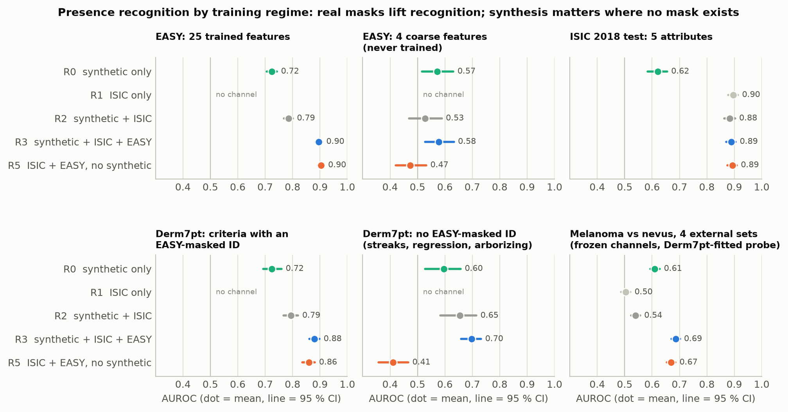
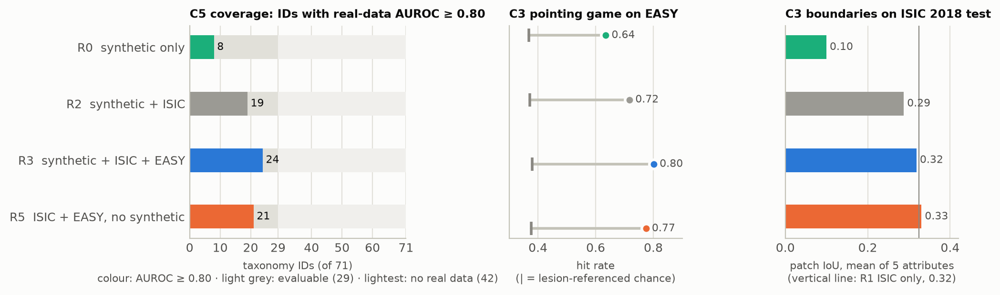
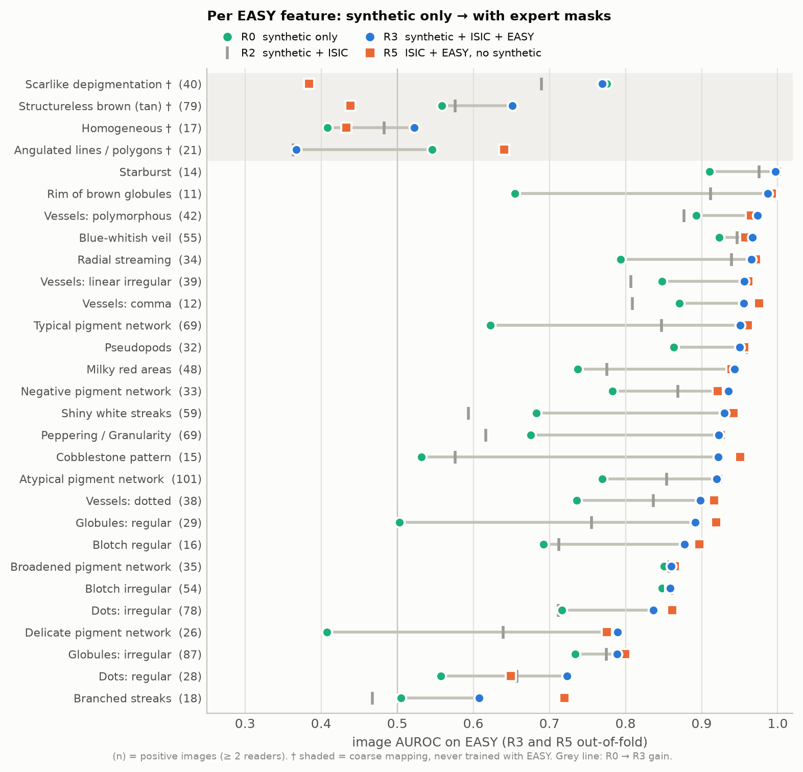
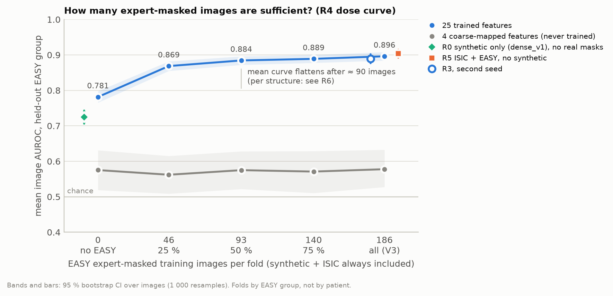
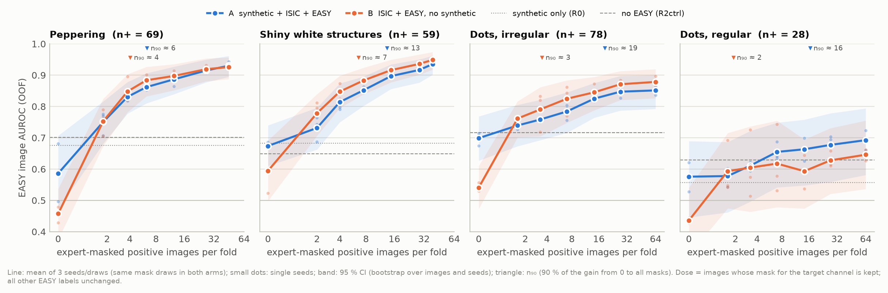
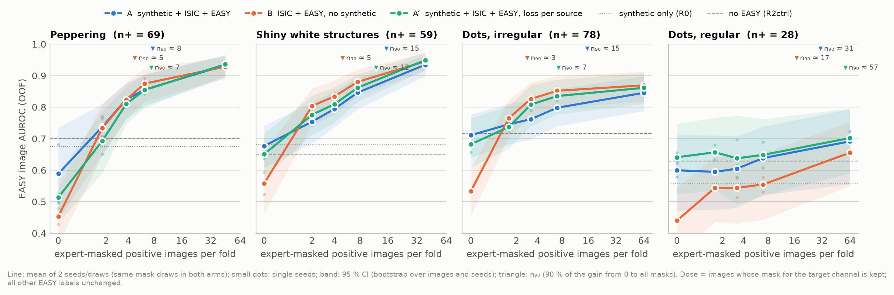

# Mission results: synthetic glyphs only vs. synthetic + real (dermatologist) masks

Date: 2026-10-21, updated 2026-10-22 (per-structure dose experiment R6, which replaces the "≈ 3 masks per structure" estimate) · Mission: `MISSION_synthetic_vs_mixed.md` · All numbers: `models/mission_compare.json` · Figures: `out/mission_fig_*.png` / `.pdf` (`mission_figures.py`)

## Regimes and what was run
| Regime | Training data | Checkpoint(s) | EASY predictions |
|---|---|---|---|
| R0 | synthetic only | `dense_v1.pt` (existing); same-pipeline retrain `mission_r0pipe_f0.pt` (+ seed 1 `mission_r0pipes1_f0.pt`); image-level `synth_v1.pt` (R0img) | all images (never saw EASY) |
| R1 | ISIC 2018 only (5 attribute channels) | `real_only.pt` | all images |
| R2 | synthetic + ISIC (V2) | `frozen_V2/models_full/hybrid.pt`; control `hybrid_v3_noeasy.pt` (R2ctrl, = dose 0 %) | all images |
| R3 | synthetic + ISIC + EASY (V3) | `hybrid_v3_f1..f4.pt` (OOF), `f0` for ISIC/Derm7pt/external; seed 1: `mission_r3s1_f1..f4.pt` | OOF by `group` |
| R4 | as R3, 25/50/75 % of the training-fold EASY images (stratified by exemplar feature, nested subsets: 46/93/140 of 186) | `mission_dose{25,50,75}_f1..f4.pt` | OOF by `group` |
| R5 | ISIC + EASY, **no synthetic** | `mission_r5_f1..f4.pt` (OOF), `mission_r5_f0.pt` | OOF by `group` |
| R6 A | as R3; masks of 3 target channels (DS038 peppering, DS006 shiny white, DS037 dots) kept for only n = 0/2/4/8/16/32/all positive training images, 3 seeds | `mission_td{n}_s{0,1,2}_f1..f4.pt`; all = R3, R3_s1, `mission_tdall_s2` | OOF by `group` |
| R6 B | as R6 A, **no synthetic** (same mask draws per seed) | `mission_tdB{n}_s{0,1,2}_f1..f4.pt`; all = R5, `mission_tdBall_s{1,2}` | OOF by `group` |
| R6 A′ | as R6 A, loss averaged per source (`--srcnorm 1`), n = 0/2/4/8/all, 2 seeds | `mission_tdS{n}_s{0,1}_f1..f4.pt`, `mission_tdSall_s{0,1}` | OOF by `group` |

New runs use `mission_train.py`, a parametrised copy of the `hybrid3.py` loop. It keeps the same architecture (ViT-S/16, CLS + 14×14 head, 76 outputs), the same folds, 16 × 166 optimiser steps and seed 0. A disabled source is dropped from the batch and nothing replaces it. R5 therefore sees the same ISIC/EASY samples per step as R3, but its 47 ID channels without an EASY mapping get no supervision at all.

Pipeline check: my prediction code reproduces `easy_pred_v3oof.npz` / `easy_pred_v2check.npz` exactly, and the published means V2 0.785 / V3 0.896.

Scripts: `mission_train.py` (R6 switches `--tids`, `--tdose`, `--srcnorm`), `td_eval.py` (R6 evaluation → `models/td_dose.json`, `models/td_dose_A2.json`), `mission_pred.py` (predictions + `lesion_seg.pt` on EASY), `mission_ext.py` (4 external sets), `mission_compare.py`, `mission_report.py`. Logs are in `logs_mission/`.

**Protocols.**
- EASY: exactly as `easy_eval.py` (450 px, 4 corners + centre + whole view, 14×14, max over views and cells, positive ≥ 2 readers, negative = no reader, 1 reader excluded). Bootstrap: 1 000 resamples over images, paired across regimes, so the CI of a mean over features keeps the correlation between features.
- Rank and generic control: computed among the **71 ID channels** for every regime, so the denominator is the same everywhere.
- ISIC: test blocks of `hybrid.py` (500 images), with thresholds from the cal blocks.
- Derm7pt: official test split (395), zero-shot, ID-channel map max over the 5 tiles (taxonomy mapping of `transfer_dense.py`).
- C6 uses **frozen** regime models, so no regime gets Derm7pt fine-tuning:
  - (a) the 7-point rule of `external_check.old_rule` on top-3-mean image-head scores over lesion tiles;
  - (b) a logistic probe on the same scores, fitted on Derm7pt train+valid.
  - Tasks: melanoma vs nevus, on Derm7pt test and on the 4 external sources (MEL+NV of `external_check.datasets()`, 1 888 / 3 200).
  - These C6 numbers are therefore lower than the V3 deliverable (0.749 pooled), which uses `mel_final.pt` fine-tuned on Derm7pt. They are only for comparing regimes.

## Table A: capabilities × regimes (mean [95 % CI])

| Capability / metric | n | R0 | R1 | R2 | R3 | R5 |
|---|---|---|---|---|---|---|
| **C1** EASY mean image AUROC, 25 trained features (mapped ID channel) | 248 img, 25 feat | 0.724 [0.71, 0.74] | – | 0.785 [0.77, 0.80] | 0.896 [0.88, 0.91] | 0.904 [0.89, 0.91] |
| C1 EASY, 4 coarse-mapped features (never trained) | 248 img, 4 feat | 0.572 [0.52, 0.63] | – | 0.528 [0.47, 0.59] | 0.578 [0.53, 0.63] | 0.474 [0.42, 0.53] |
| C1 EASY, ISIC-attribute channel of the mapped features | 14 feat | 0.683 | 0.823 | 0.809 | 0.825 | 0.824 |
| C1 ISIC 2018 test, image AUROC, mean of 5 attributes | 500 img | 0.620 [0.58, 0.65] | 0.896 [0.88, 0.91] | 0.883 [0.86, 0.90] | 0.889 [0.87, 0.90] | 0.893 [0.87, 0.91] |
| C1 Derm7pt test, zero-shot criterion AUROC, mean | 395 img, 9 crit. | 0.682 [0.65, 0.71] | – | 0.747 [0.72, 0.77] | 0.819 [0.80, 0.84] | 0.710 [0.69, 0.73] |
|   … criteria with an EASY-supervised ID | network (any), network (atypical), dots/globules, blue-whitish veil, vessels: dotted, vessels: comma | 0.725 [0.69, 0.76] | – | 0.794 [0.77, 0.82] | 0.879 [0.86, 0.90] | 0.860 [0.84, 0.88] |
|   … criteria without an EASY-supervised ID | streaks, regression, vessels: arborizing | 0.596 [0.53, 0.66] | – | 0.654 [0.58, 0.71] | 0.697 [0.66, 0.73] | 0.410 [0.36, 0.47] |
| **C2** EASY median rank of mapped channel (of 71 IDs) | 25 feat | 6 | – | 2 | 1 | 1 |
| C2 share of features where mapped channel is rank 1 / top 3 | 25 feat | 0.20 / 0.40 | – | 0.32 / 0.60 | 0.80 / 0.96 | 0.76 / 0.88 |
| C2 generic-score control AUROC (mean of 71 ID scores) → AUROC − generic | 25 feat | 0.562 → +0.162 | – | 0.579 → +0.206 | 0.587 → +0.309 | 0.589 → +0.315 |
| **C3** EASY pointing game (hit rate) vs lesion-referenced chance | positives, 29 feat | 0.64 vs 0.37 | – | 0.72 vs 0.37 | 0.80 vs 0.38 | 0.77 vs 0.38 |
| C3 EASY cell AUROC inside lesion + border | 29 feat | 0.666 | – | 0.714 | 0.800 | 0.795 |
| C3 ISIC test patch IoU (threshold from cal blocks), mean 5 attr. | 500 img | 0.100 | 0.324 | 0.288 | 0.318 | 0.331 |
| C3 ISIC pointing (chance in lesion+rim 0.21) | tiles with GT | 0.388 | 0.649 | 0.636 | 0.612 | 0.665 |
| **C4** EASY share of top region (≥ 50 % of map max) outside lesion + border | area outside ≈ 0.45 | 0.046 | – | 0.008 | 0.006 | 0.030 |
| C4 ISIC share of thresholded mass outside lesion + border | test tiles | 0.231 | 0.010 | 0.016 | 0.019 | 0.011 |
| **C5** IDs with AUROC ≥ 0.80 / IDs evaluable (EASY) | of 71 IDs | 8 / 25 | 0 / 0 | 14 / 25 | 20 / 25 | 20 / 25 |
| C5 … (EASY+Derm7pt) | of 71 IDs | 8 / 28 | 0 / 0 | 15 / 28 | 23 / 28 | 21 / 28 |
| C5 … (EASY+Derm7pt+ISIC) | of 71 IDs | 8 / 29 | 0 / 0 | 19 / 29 | 24 / 29 | 21 / 29 |
| **C6** melanoma vs nevus, zero-shot 7-point rule on glyph channels: Derm7pt test | 101 MEL / 219 NV | 0.671 [0.60, 0.73] | – | 0.603 [0.53, 0.66] | 0.728 [0.67, 0.79] | 0.745 [0.69, 0.80] |
| **C6** melanoma vs nevus, zero-shot 7-point rule on glyph channels: external pooled | 1888 MEL / 3200 NV | 0.617 [0.60, 0.63] | – | 0.547 [0.53, 0.56] | 0.680 [0.66, 0.70] | 0.661 [0.65, 0.68] |
| **C6** melanoma vs nevus, logistic probe on channel scores, fitted on Derm7pt train+valid: Derm7pt test | 101 MEL / 219 NV | 0.769 [0.71, 0.82] | 0.635 [0.57, 0.70] | 0.717 [0.65, 0.77] | 0.844 [0.80, 0.89] | 0.866 [0.82, 0.90] |
| **C6** melanoma vs nevus, logistic probe on channel scores, fitted on Derm7pt train+valid: external pooled | 1888 MEL / 3200 NV | 0.610 [0.59, 0.63] | 0.503 [0.49, 0.52] | 0.540 [0.52, 0.56] | 0.686 [0.67, 0.70] | 0.669 [0.65, 0.69] |

Notes on Table A:
- **Extra rows.** Synthetic-only retrained with the V3 pipeline (R0pipe): EASY 0.702 [0.68, 0.72], seed 1 0.706. The V3-pipeline no-EASY control (R2ctrl): 0.781. Both are in the JSON.
- **Image head vs region head.** The image-level `synth_v1.pt` (R0img) scores 0.685, so the region head of `dense_v1` is the better R0 readout.
- **R1 is not comparable on C1.** R1 has only the 5 ISIC channels. On the 14 EASY features that map to an ISIC channel it scores 0.823, and its channels are as good as those of the hybrids there (third table below). It has no ID channels, so C2/C5 do not apply.
- **C3 chance level.** Pointing chance is now lesion-referenced: `lesion_seg.pt` mask, dilated by 1 cell, giving 0.37–0.38. The old any-reader-area proxy gave 0.44–0.46, so the old proxy overstated chance. Pointing is well above chance in every regime.
- **C4 on EASY** is threshold-free: the share of cells ≥ 50 % of the map maximum that lie outside lesion + border. About 45 % of the area lies outside.
- **C5** counts IDs with at least one real-data target with n+ ≥ 10 and AUROC ≥ 0.80. The sources are EASY features, the Derm7pt criteria via the taxonomy mapping, and the ISIC attributes via the taxonomy mapping. Only **29 of the 71 IDs can be evaluated on any public real data at all.** The other 42 are unvalidated in every regime.
  - R0 passes 8 IDs: DS003, DS023, DS024, DS048, DS049, DS065, DS067, DS069.
  - R3 passes 24.
  - Under the weaker criterion "lower 95 % bound > 0.5", R0 passes 19 of 25 EASY-evaluable IDs.

## Table B: per EASY feature (OOF for R3/R5); cells are AUROC (rank among 71 IDs, generic control)
† = coarse mapping, never trained with EASY (reported separately in Table A).

| EASY feature | n+ / n− | R0 AUROC (rank, generic) | R2 | R3 (OOF) | R5 (OOF) | R3 − R0 | R5 − R3 |
|---|---|---|---|---|---|---|---|
| Dots : Irregular | 78 / 123 | 0.72 (3, 0.67) | 0.71 (2, 0.62) | 0.84 (1, 0.74) | 0.86 (1, 0.85) | +0.12 | +0.03 |
| Dots : Regular | 28 / 183 | 0.56 (7, 0.39) | 0.66 (6, 0.41) | 0.72 (3, 0.36) | 0.65 (11, 0.42) | +0.17 | -0.07 |
| Globules / Clods : Cobblestone pattern | 15 / 219 | 0.53 (25, 0.45) | 0.58 (36, 0.61) | 0.92 (1, 0.39) | 0.95 (1, 0.37) | +0.39 | +0.03 |
| Globules / Clods : Irregular | 87 / 98 | 0.73 (6, 0.74) | 0.78 (1, 0.72) | 0.79 (3, 0.78) | 0.80 (2, 0.84) | +0.06 | +0.01 |
| Globules / Clods : Regular | 29 / 191 | 0.50 (13, 0.43) | 0.76 (2, 0.54) | 0.89 (1, 0.45) | 0.92 (1, 0.43) | +0.39 | +0.03 |
| Globules / Clods : Rim of brown globules | 11 / 219 | 0.65 (21, 0.73) | 0.91 (2, 0.79) | 0.99 (1, 0.62) | 0.99 (1, 0.66) | +0.33 | +0.01 |
| Lines : Angulated lines / Polygons / Zig-zag pattern † | 21 / 218 | 0.55 (–, 0.51) | 0.36 (–, 0.33) | 0.37 (–, 0.37) | 0.64 (–, 0.52) | -0.18 | +0.27 |
| Lines : Branched streaks | 18 / 187 | 0.50 (29, 0.54) | 0.47 (40, 0.48) | 0.61 (11, 0.42) | 0.72 (5, 0.57) | +0.10 | +0.11 |
| Lines : Pseudopods | 32 / 197 | 0.86 (3, 0.78) | 0.96 (1, 0.85) | 0.95 (1, 0.73) | 0.96 (2, 0.69) | +0.09 | +0.01 |
| Lines : Radial streaming | 34 / 181 | 0.79 (9, 0.76) | 0.94 (1, 0.79) | 0.97 (1, 0.69) | 0.97 (1, 0.65) | +0.17 | +0.01 |
| Network : Atypical pigment network / Reticulation | 101 / 116 | 0.77 (1, 0.63) | 0.85 (1, 0.55) | 0.92 (1, 0.53) | 0.92 (1, 0.69) | +0.15 | +0.00 |
| Network : Broadened pigment network / Reticulation | 35 / 162 | 0.85 (1, 0.69) | 0.86 (2, 0.59) | 0.86 (2, 0.49) | 0.86 (3, 0.56) | +0.01 | +0.01 |
| Network : Delicate Pigment Network / Reticulation | 26 / 167 | 0.41 (10, 0.27) | 0.64 (2, 0.24) | 0.79 (1, 0.24) | 0.78 (7, 0.39) | +0.38 | -0.01 |
| Network : Negative pigment network | 33 / 194 | 0.78 (1, 0.51) | 0.87 (1, 0.61) | 0.94 (1, 0.65) | 0.92 (1, 0.70) | +0.15 | -0.01 |
| Network : Typical pigment network / Reticulation | 69 / 146 | 0.62 (6, 0.45) | 0.85 (4, 0.35) | 0.95 (1, 0.23) | 0.96 (1, 0.36) | +0.33 | +0.01 |
| Pattern : Homogeneous : NOS † | 17 / 174 | 0.41 (53, 0.40) | 0.48 (38, 0.47) | 0.52 (21, 0.44) | 0.43 (52, 0.47) | +0.11 | -0.09 |
| Pattern : Starburst | 14 / 224 | 0.91 (2, 0.75) | 0.98 (2, 0.83) | 1.00 (1, 0.63) | 1.00 (1, 0.48) | +0.09 | +0.00 |
| Regression structures : Peppering / Granularity | 69 / 133 | 0.68 (7, 0.66) | 0.62 (14, 0.57) | 0.92 (1, 0.67) | 0.93 (1, 0.78) | +0.25 | +0.00 |
| Regression structures : Scarlike depigmentation † | 40 / 167 | 0.78 (2, 0.70) | 0.69 (5, 0.60) | 0.77 (4, 0.71) | 0.38 (65, 0.76) | -0.01 | -0.39 |
| Shiny white structures : Shiny white streaks | 59 / 166 | 0.68 (27, 0.65) | 0.59 (37, 0.67) | 0.93 (1, 0.79) | 0.94 (1, 0.70) | +0.25 | +0.01 |
| Structureless : Blotch irregular | 54 / 150 | 0.85 (3, 0.80) | 0.86 (1, 0.76) | 0.86 (1, 0.78) | 0.86 (1, 0.82) | +0.01 | +0.00 |
| Structureless : Blotch regular | 16 / 209 | 0.69 (9, 0.51) | 0.71 (14, 0.58) | 0.88 (1, 0.44) | 0.90 (1, 0.32) | +0.18 | +0.02 |
| Structureless : Blue-whitish veil | 55 / 155 | 0.92 (1, 0.77) | 0.95 (1, 0.75) | 0.97 (1, 0.80) | 0.96 (1, 0.79) | +0.04 | -0.01 |
| Structureless : Milky red areas | 48 / 168 | 0.74 (23, 0.62) | 0.78 (8, 0.60) | 0.94 (1, 0.74) | 0.94 (1, 0.67) | +0.21 | -0.00 |
| Structureless : Structureless brown (tan) † | 79 / 110 | 0.56 (3, 0.36) | 0.58 (2, 0.35) | 0.65 (1, 0.48) | 0.44 (60, 0.57) | +0.09 | -0.21 |
| Vessels : Comma | 12 / 220 | 0.87 (2, 0.19) | 0.81 (8, 0.26) | 0.96 (1, 0.54) | 0.98 (1, 0.36) | +0.08 | +0.02 |
| Vessels : Dotted | 38 / 182 | 0.74 (9, 0.29) | 0.84 (1, 0.40) | 0.90 (1, 0.60) | 0.92 (1, 0.53) | +0.16 | +0.02 |
| Vessels : Linear irregular | 39 / 186 | 0.85 (4, 0.34) | 0.81 (7, 0.40) | 0.96 (2, 0.67) | 0.96 (1, 0.51) | +0.11 | +0.01 |
| Vessels : Polymorphous | 42 / 187 | 0.89 (1, 0.45) | 0.88 (2, 0.49) | 0.97 (1, 0.73) | 0.96 (1, 0.56) | +0.08 | -0.01 |

Task 2, the R1 baseline on EASY: the ISIC-attribute channels (R0 = union of its mapped IDs):

| EASY feature (ISIC channel) | R0 (union of IDs) | R1 real only | R2 | R3 | R5 |
|---|---|---|---|---|---|
| Dots : Irregular (globules) | 0.69 | 0.67 | 0.68 | 0.74 | 0.69 |
| Dots : Regular (globules) | 0.52 | 0.66 | 0.59 | 0.63 | 0.65 |
| Globules / Clods : Cobblestone pattern (globules) | 0.57 | 0.87 | 0.84 | 0.82 | 0.85 |
| Globules / Clods : Irregular (globules) | 0.77 | 0.74 | 0.77 | 0.78 | 0.76 |
| Globules / Clods : Regular (globules) | 0.58 | 0.86 | 0.82 | 0.83 | 0.86 |
| Globules / Clods : Rim of brown globules (globules) | 0.75 | 0.92 | 0.92 | 0.91 | 0.91 |
| Lines : Branched streaks (streaks) | 0.47 | 0.59 | 0.53 | 0.57 | 0.60 |
| Lines : Pseudopods (streaks) | 0.84 | 0.96 | 0.95 | 0.96 | 0.97 |
| Lines : Radial streaming (streaks) | 0.84 | 0.96 | 0.94 | 0.96 | 0.94 |
| Network : Atypical pigment network / Reticulation (pigment_network) | 0.74 | 0.82 | 0.82 | 0.82 | 0.82 |
| Network : Broadened pigment network / Reticulation (pigment_network) | 0.84 | 0.86 | 0.88 | 0.88 | 0.87 |
| Network : Delicate Pigment Network / Reticulation (pigment_network) | 0.46 | 0.74 | 0.77 | 0.77 | 0.75 |
| Network : Negative pigment network (negative_network) | 0.78 | 0.92 | 0.86 | 0.93 | 0.91 |
| Network : Typical pigment network / Reticulation (pigment_network) | 0.69 | 0.96 | 0.94 | 0.95 | 0.95 |

## Figure: EASY dose curve (R4)

| EASY training images per fold | 0 (R2ctrl) | 46 (25 %) | 93 (50 %) | 140 (75 %) | 186 (R3) | 186, no synthetic (R5) |
|---|---|---|---|---|---|---|
| mean AUROC, 25 trained features | 0.781 | 0.869 | 0.884 | 0.889 | 0.896 (seed 1: 0.889) | 0.904 |
| step gain [95 % CI] | | +0.087 [+0.073, +0.101] | +0.016 [+0.007, +0.024] | +0.004 [−0.002, +0.011] | +0.007 [+0.001, +0.014] | |
| 4 coarse features (untrained) | 0.575 | 0.562 | 0.575 | 0.571 | 0.578 (seed 1: 0.628) | 0.474 |

**Seed variance.** For the trained-feature mean it is small: R3 vs R3 seed 1 is −0.007 [−0.014, +0.001], and R0pipe vs seed 1 is +0.003. For the 4 untrained features it is large (0.578 vs 0.628), so no conclusion should be drawn from differences on those features.

**The R4 mean does not give a number of masks per structure.** EASY features co-occur, so 93 images give each trained channel a median of about 12 positive training images (image-level count), not ≈ 3. The mean also mixes features that keep improving with features that never respond. R6 measures the per-structure dose directly.

## Per-structure dose experiment (R6)

Design: three structures with many positives and room to improve, none supervised by ISIC. Every EASY image stays in training for all other channels; for each target channel only n positive training images keep their mask (excluded from the loss otherwise, never relabelled negative), negatives unchanged. Draws are independent per channel, nested over n within a seed, identical across arms. Dose = image-level supervised positives per fold (mean over folds); a few positives with < 1 % coverage count as image-level negatives in the original pipeline, so effective n is slightly below nominal (≈ 1.5–2 / 3–4 / 6–7.5 / 12–15 / 27–29; all = 45 peppering, 39 shiny white, 64 dots). Uncertainty: bootstrap over images (1 000) combined with resampling of seeds; arms paired.

**Arm A (synthetic + ISIC + EASY, 3 seeds): AUROC by masked positives per fold**

| Structure (n+) | 0 | ≈ 2 | ≈ 4 | ≈ 7 | ≈ 14 | ≈ 28 | all | n₉₀ [95 % CI] |
|---|---|---|---|---|---|---|---|---|
| Peppering (69) | 0.59 | 0.75 | 0.83 | 0.86 | 0.89 | 0.92 | 0.93 | 6 [4, 11] |
| Shiny white structures (59) | 0.67 | 0.73 | 0.81 | 0.85 | 0.90 | 0.92 | 0.94 | 13 [8, 21] |
| Dots, irregular (78) | 0.70 | 0.74 | 0.76 | 0.78 | 0.83 | 0.85 | 0.85 | 19 [10, 33] |
| Dots, regular (28) | 0.58 | 0.58 | 0.61 | 0.66 | 0.66 | 0.68 | 0.69 | not usable |

n₉₀ = masks for 90 % of the gain from 0 to all masks (saturating fit). It is relative to each arm's own start and to the cap, so compare arms with the fixed-AUROC table below. Seed SD ≤ 0.02 from about 4 masks on (exceptions: peppering at 0, regular dots). Mapped channel rank 1–2 of 71 from 2 masks (peppering, irregular dots) or 4 masks (shiny white). Pointing game keeps improving to the full dose (peppering 0.36 → 0.82, lesion chance 0.26).

**Masked positives needed to reach a fixed AUROC (interpolated on the log-dose curve)**

| Structure | 0.80: A / B | 0.85: A / B | 0.90: A / B |
|---|---|---|---|
| Peppering | 3 / 3 | 5 / 4 | 18 / 14 |
| Shiny white structures | 4 / 3 | 7 / 4 | 16 / 11 |
| Dots, irregular | 9 / 4 | ≈ 49 / 16 (A barely reaches 0.85) | not reached |

**Arm B − arm A (no synthetic minus synthetic, 3 seeds, paired):** at 0 masks −0.13 [−0.24, −0.03] (peppering), −0.08 [−0.19, +0.02] (shiny white), −0.16 [−0.25, −0.07] (irregular dots); B starts near chance (0.46–0.60). From 2 masks on B is level or slightly better: −0.01 to +0.05; one of 18 comparisons has a CI excluding 0 (shiny white at ≈ 7: +0.03 [+0.00, +0.06]).

**Loss-weighting control (arm A′).** `hybrid.masked_bce` averages over all supervised entries of the batch, so with 96 synthetic rows per step the EASY masks carry a much smaller share of the loss in A than in B. A′ keeps the synthetic data but averages the loss separately over synthetic and real rows, so the real part equals B's loss.

| Structure | B − A at 2–8 masks | A′ − A at 2–8 | **A′ − B at 2–8** |
|---|---|---|---|
| Peppering | 0.00 to +0.02 | −0.05 to 0.00 | −0.04 to −0.01, CIs include 0 |
| Shiny white structures | +0.03 to +0.05 | +0.02 | −0.03 to −0.02, CIs include 0 |
| Dots, irregular | +0.02 to +0.06 | −0.01 to +0.05 | −0.03 to −0.02, CIs include 0 |
| Dots, regular | −0.08 to −0.05 | +0.01 to +0.06 | **+0.09 to +0.11**, all CIs exclude 0 |

(Seeds 0–1 and doses 0/2/4/8/all for all three arms in this table; `models/td_dose_A2.json`.) Part of B's edge was the weighting (≈ 70 % of the gap for irregular dots at 4 masks, ≈ 40 % for shiny white), but even with equal weighting synthesis does not help once ≥ 2 masks exist. Exception: regular dots (28 positives), where A′ beats B at every dose. At 0 masks A′ keeps most of the zero-shot value for shiny white and irregular dots (0.65 / 0.68 vs B 0.56 / 0.53), not for peppering (0.51).

**Peppering at 0 masks** is below R0/R2ctrl in A (0.59 vs 0.68/0.70) and unstable across seeds (0.68 / 0.50 / 0.58): with dose 0 the peppering images are in training but their peppering label is ignored, which may push the channel down on exactly those images. Use R0/R2ctrl as the "no real masks" reference.

## Answers

**What can a classifier trained only on synthetic glyphs do for a dermatologist?**
- **Presence.** It recognises several structures on real expert-annotated images clearly above chance without ever having seen a real mask. Mean EASY AUROC is 0.72 [0.71, 0.74] over 25 features.
- **Strongest structures (≥ 0.85):** blue-whitish veil 0.92, starburst 0.91, polymorphous 0.89, comma 0.87, pseudopods 0.86, broadened network and irregular blotch 0.85, linear irregular vessels 0.85.
- **Specificity.** The firing is not just "melanoma-ness". The mapped channel beats the generic all-channel score by +0.16 AUROC on average and is in the top 3 for 40 % of features. For vessels the generic score is 0.2–0.45, so here the gain over the generic score is clear.
- **Coverage.** It provides a channel for all 71 IDs. On real data, though, only 8 of the 29 evaluable IDs reach AUROC ≥ 0.80, and 42 IDs cannot be checked at all.
- **Localisation is rough but plausible.** The pointing game on EASY is 0.64 vs 0.37 lesion chance, and the top-scoring regions stay inside lesion + border (5 % outside vs 44 % of the area). ISIC patch IoU is only 0.10, against 0.32 for real-mask models.
- **What it cannot do.** It fails on network subtypes (delicate 0.41, typical 0.62), regular/cobblestone globules (0.50–0.53), branched streaks (0.50), shiny white streaks (0.68) and milky-red areas. It cannot give boundaries. It also cannot serve as a feature extractor on new sources: the external melanoma probe reaches only 0.61.

**What does adding real dermatologist masks change, and for which structure types?**
- **ISIC 2018 masks (R0 → R2).** They lift EASY by +0.06 [+0.05, +0.08]. Most of the gain is in the network family (typical +0.23, delicate +0.23) and globules (regular +0.26, rim +0.26), i.e. the ISIC attribute families. They also bring IoU from 0.10 to about 0.29–0.32 on ISIC.
- **EASY expert masks (R2 → R3).** They add +0.11 [+0.10, +0.13] on EASY (OOF). The largest gains are on structures that ISIC lacks:
  - cobblestone +0.34, shiny white streaks +0.34, peppering +0.30, milky-red areas +0.16;
  - vessels: dotted +0.06, linear irregular +0.15, comma +0.15.
- **Ranking.** With EASY, the mapped channel becomes rank 1 for 80 % of features (R0 20 %, R2 32 %).
- **Transfer.** The gains carry over to Derm7pt zero-shot (0.75 → 0.82) and to the frozen downstream tasks: melanoma probe on Derm7pt 0.72 → 0.84, external pooled 0.54 → 0.69.
- **Structures already strong without EASY** stay flat: blue veil, irregular blotch, broadened network, pseudopods.
- **An oddity.** R2 is worse than R0 on the zero-shot 7-point rule (Derm7pt 0.60 vs 0.67, external 0.55 vs 0.62). Adding ISIC alone shifts the channel scales that the unweighted rule sums; EASY repairs this.

**How many expert-masked images are sufficient, and does synthesis still add value once real masks are present?**
- **Image-subsample curve (R4).** The mean over 25 features rises steeply up to 46 EASY images per fold (+0.087), gains another +0.016 up to 93 images and is flat after that. This is a statement about the mean, not about masks per structure (93 images = median ≈ 12 positives per channel).
- **Per structure (R6).** For distinctive structures with many positives, **3–4 masked positive images give AUROC 0.80, 4–7 give 0.85, 11–18 give 0.90**. Subtle structures need more: irregular dots need 4–9 masks for 0.80 and do not reach 0.90 with 64. Peppering and shiny white are still rising at the cap (39–45 masks). Regular dots (28 positives) are inconclusive.
- **Synthesis does not reduce the number of masks needed.** It gives a zero-shot start (0.59–0.70 vs 0.46–0.60 without), but from 2 masks on the no-synthetic arm is level or slightly better, and with equal loss weighting (A′) the difference A′ − B is −0.04 to −0.02, not significant. Exception: regular dots, where A′ beats B by +0.09 to +0.11.
- **Does synthesis still help? On the structures that have expert masks, no.** R5 (ISIC + EASY, no synthetic) equals R3 on the 25 EASY-trained features: 0.904 vs 0.896, difference −0.008 [−0.016, +0.002]. It is also equal on ISIC (0.893 vs 0.889 AUROC, 0.33 vs 0.32 IoU) and on the Derm7pt melanoma probe (0.866 vs 0.844). R3 vs R5 carries the loss-weighting imbalance described under R6; the equal-weighting control A′ confirms the conclusion for the three R6 structures.
- **Synthesis adds value wherever there is no real mask:**
  - Derm7pt criteria whose IDs have no EASY supervision: streaks DS008, regression DS051, arborizing DS072. Here R3 scores 0.70 and R5 0.41 (below chance; its channels are untrained).
  - The 4 coarse EASY features (0.58 vs 0.47).
  - Structures with very few real positives: regular dots in R6 (A′ vs B +0.09 to +0.11).
  - The 42 IDs with no real data at all.
- **Weak broader gain.** On the external sets, R3 beats R5 by a small but consistent margin: pooled rule +0.019 [+0.009, +0.031], probe +0.017 [+0.001, +0.031]. It is not uniform across sources: on BCN the probe favours R5.
- So synthesis no longer improves recognition of structures that have masks. What it adds is **breadth**: structures without masks get a trained, partly transferable channel, and the external sets show a small robustness gain.

## Proposed conclusion sentence for the paper
> *Training a dermoscopic structure detector on artificially generated glyphs alone yields a usable but limited starting point (EASY mean AUROC 0.72, plausible lesion-confined maps, but poor boundaries). Adding dermatologist-masked lesions is necessary for reliable recognition and raises performance to 0.89–0.90; per structure, a handful of masks suffices for distinctive structures (3–4 masked images for AUROC 0.80, 4–7 for 0.85), whereas subtle structures need more. Once two or more masks exist for a structure, synthesis adds nothing for that structure, even with equal loss weighting; its lasting value is breadth: it provides working, partly transferable detectors for structures without any real masks, which real-data-only training cannot provide.*

Short form: *"Synthetic glyphs provide breadth and a usable starting point; real dermatologist masks are necessary for reliable recognition, and a handful per structure (about 5–10 for AUROC ≈ 0.85) suffices for distinctive structures."*

The original sentence ("works well; even better with a sufficient mix") overstates R0 and implies that the mix beats real data, which R5 and R6 do not support for mask-covered structures. The earlier wording "about 90 images, ≈ 3 per structure" came from the R4 mean and is withdrawn (see R6). The conclusion above matches paper V7 (`Papers/build_v7/build_v7.py`).

## Caveats (must accompany the numbers)
- **Folds** follow EASY `group` (1–4, identical to `hybrid3.py`). They are **not split by patient or lesion**, so OOF gains (R3–R6) may be optimistic. This affects R3 and R5 equally, so R5 vs R3 is less affected than R3 vs R0.
- **Exemplar selection.** EASY images are exemplars, mostly melanoma or nevus, with co-occurring features. A high AUROC can partly reflect lesion type, which is why rank and the generic control are reported. The generic control alone reaches up to 0.85 for some features (e.g. dots irregular in R5).
- **Small samples.** Bootstrap is over images, so the intervals are probably too narrow. Several features have n+ of only 11–18 (rim of brown globules, comma, starburst, cobblestone, blotch regular, homogeneous, branched streaks), and arborizing on Derm7pt has n+ = 13.
- **Taxonomy mappings** (Derm7pt/ISIC → IDs) are manual. Regression (DS051) is a poor mapping in every regime.
- **C6 uses frozen models** (no Derm7pt fine-tuning, unlike the deliverable pipeline), and its tile selection differs from `external_check.py`.
- **One subsample draw** per R4 dose point; seed variance was checked only for R0pipe and R3.
- **R6 scope.** Only 3 structures with 59–101 positives; 3 seeds (A′: 2 seeds, 5 doses); dose capped at 39–64 masks per fold, and two structures are still rising there, so n₉₀ may underestimate the masks needed to reach their ceiling. Rare or subtle structures may need more. Regular and irregular dots share channel DS037 and therefore the dose.
- **Loss weighting.** The batch-averaged loss gives real rows less weight when synthetic rows are present (R2–R4, R6 A). Comparisons with/without synthetic should use the equal-weighting control (R6 A′) where available.
- The histopathology subset of v17 was not used.
